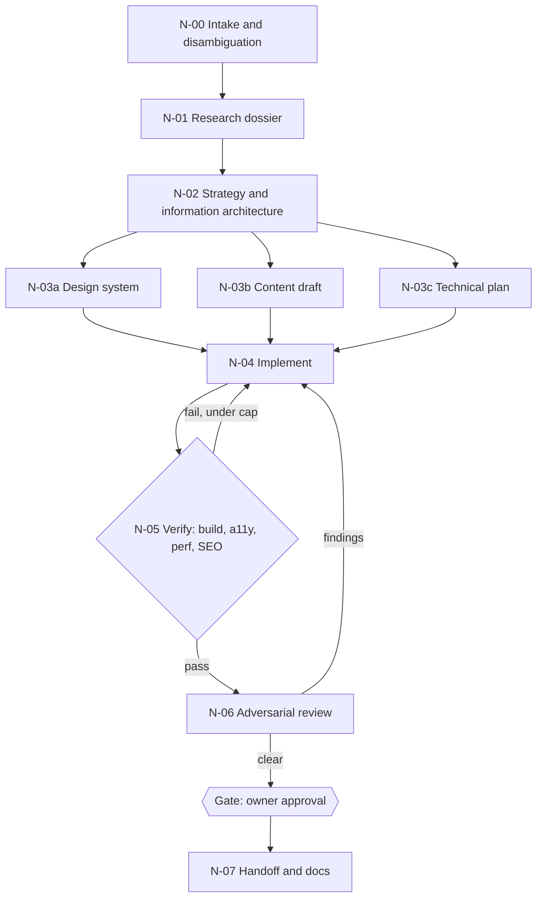

# Title: Project Doc Blueprint Graph Engineering Playbook

How to model agent work as graphs, and how to model a project's knowledge as a graph.

Status: Proposed
Last updated: 2026-10-20

"Graph engineering" can mean two things. This playbook covers both and marks the assumption: **Open**, confirm which one you meant, or keep both.

- **Part A. Workflow graphs:** agents, tools, and gates as nodes; handoffs as edges.
- **Part B. Knowledge graphs:** documents, requirements, decisions, components, and tests as nodes; relationships as edges.

This is synthesis from common practice, not a vendor specification. Test it before adopting it as a standard.

## Part A. Workflow graphs

### A1. Why a graph

A single long prompt mixes concerns and hides checkpoints. A graph makes each step small, testable, and replaceable, and shows where parallel work is safe.

### A2. Elements

| Element | Meaning |
|---|---|
| Node | One unit of work: an agent step, a tool call, a deterministic script, or a human gate |
| Edge | A handoff with a condition: always, on success, on failure, or on a routing decision |
| State | The shared data passed along edges (files, JSON, summaries) |
| Checkpoint | Saved state that lets a run resume after failure |
| Gate | A node that waits for a human or a verification result |
| Cycle | An edge back to an earlier node; always has an iteration cap |

### A3. Node specification

Every node is documented in `docs/ai/workflow-graph.md` with this table.

| Field | Content |
|---|---|
| ID | `N-03` |
| Role | One sentence |
| Inputs | Files or state keys read |
| Outputs | Files or state keys written, with format |
| Tier | Highest authority (T0 to T4) |
| Tools | Capabilities needed (search, read, write, run tests) |
| Exit criteria | Checkable statement |
| On failure | Retry count, fallback node, or escalate |
| Context | Fresh or inherited |

### A4. Patterns

| Pattern | Shape | Use when |
|---|---|---|
| Pipeline | A to B to C | Each stage needs the previous output |
| Fan-out and fan-in | A to (B, C, D) to E | Independent subtasks, then merge |
| Supervisor | One router sends work to specialists and collects results | Varied subtasks, one accountable owner |
| Critic loop | Maker to reviewer, back to maker, capped | Quality-sensitive output |
| Gate | Work to verification to human approval | T3 decisions, releases |
| Swarm | Peers hand off dynamically | Open-ended exploration; hardest to debug |

Default to pipeline plus fan-out. Add a supervisor only when routing genuinely varies. Avoid swarms unless you can trace and replay them.

### A5. Rules

1. **Isolate context.** A subagent starts clean and returns a summary plus file paths, not its transcript. This keeps the parent context small.
2. **Parallelize only independent work.** Reads and searches are safe. Writes to the same files are not; give writers separate files or separate working copies.
3. **One owner per output file.** Two nodes never write the same path in the same run.
4. **Typed handoffs.** Define the format of every edge payload. A free-form paragraph is not a contract.
5. **Cap every cycle.** Cycles carry an iteration limit and a stuck rule (see `loop-engineering.md`).
6. **Make nodes idempotent.** Re-running a node after a crash must not corrupt state.
7. **Failure edges are required.** Every node says what happens when it fails.
8. **Least authority per node.** A research node needs T0 and write access to `research/` only.
9. **Verify at edges.** The receiving node, or a verifier node, checks the payload before using it.
10. **Trace everything.** Each run writes a log entry per node to `memory/progress-log.md`.

### A6. Reference graph: build a site from a project name



| ID | Role | Tier | Exit criteria |
|---|---|---|---|
| N-00 | Resolve what the project name refers to; list assumptions | T0 | Interpretation stated; ambiguities listed |
| N-01 | Research the subject, audience, competitors, references | T0, writes `research/` | Coverage checklist complete; sources logged |
| N-02 | Positioning, sitemap, page jobs | T1 | Every page has a single job and a primary action |
| N-03a | Tokens, type pairing, components, both themes | T1 | `design-system.md` filled; contrast checked |
| N-03b | Copy for every page, no lorem ipsum | T1 | All sections have final or marked placeholder text |
| N-03c | Stack, structure, risks | T1 | Decisions recorded; new dependencies awaiting approval |
| N-04 | Build | T2 | Build passes |
| N-05 | Run checks | T2 | Budgets in `site-building-standards.md` met, or failures listed |
| N-06 | Review as a skeptic: security, accessibility, copy | T0 | Findings table produced |
| G1 | Owner approval | n/a | Written approval recorded in `decisions.md` |
| N-07 | Update docs, memory, handoff | T1 | `current-state.md` and `README.md` current |

The ready-to-attach orchestrator prompt is `prompts/07-graph-orchestrator.md`.

### A7. Debugging a graph

If a run fails, find the first node whose output violates its contract, not the last node that errored. Fix the contract or the node, then replay from the checkpoint before that node.

## Part B. Knowledge graphs for a project

### B1. Purpose

A knowledge graph answers questions an agent would otherwise guess at: Which requirement does this test cover? Which decision does this change supersede? Which documents mention the authentication provider?

### B2. Node and edge types

| Node type | Example |
|---|---|
| Document | `auth.md` |
| Requirement | `FR-004` |
| Decision | `D-007` |
| Component | `payment-service` |
| Test | `checkout.spec` |
| Risk or finding | `F-012` |

| Edge | Meaning |
|---|---|
| `mentions` | Document A refers to document B |
| `satisfies` | Component or test implements a requirement |
| `verified_by` | Requirement has a test |
| `supersedes` | Decision replaces an earlier decision |
| `depends_on` | Task or component needs another |
| `mitigates` | Control reduces a finding |

### B3. Start small: the document graph

The scaffold can build a document-mention graph automatically:

```
python scaffold.py graph
```

It scans `docs/` for references to other documents by file name, writes `docs/ai/doc-graph.md` with a Mermaid diagram and an adjacency table, and refreshes the README index. It shows structure, not truth: a mention does not prove consistency. Use it to find orphan documents and unexpected coupling.

### B4. Traceability matrix

For requirements-heavy projects, keep one table in `prd.md` or `testing.md`:

| Requirement | Decision | Component | Test | Status |
|---|---|---|---|---|
| FR-004 | D-007 | search-service | search.spec | Open |

A requirement with no test is an Open gap. A test with no requirement is a question to answer.

### B5. When to go further

A graph database is overkill for most projects. Move from Markdown tables to a real graph store only when you have thousands of nodes and query needs the tables cannot meet. Adopting one is a new dependency and needs a decision entry (Rule 7).
